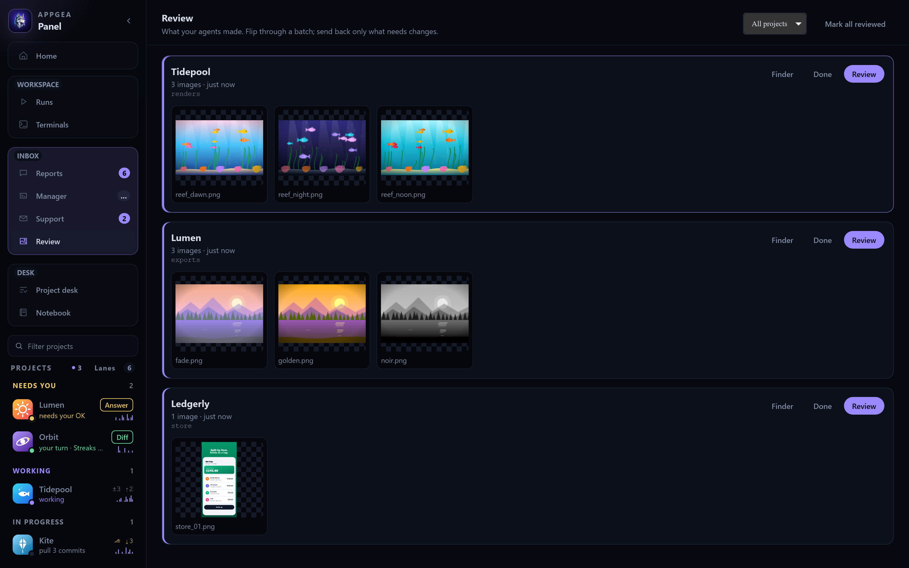
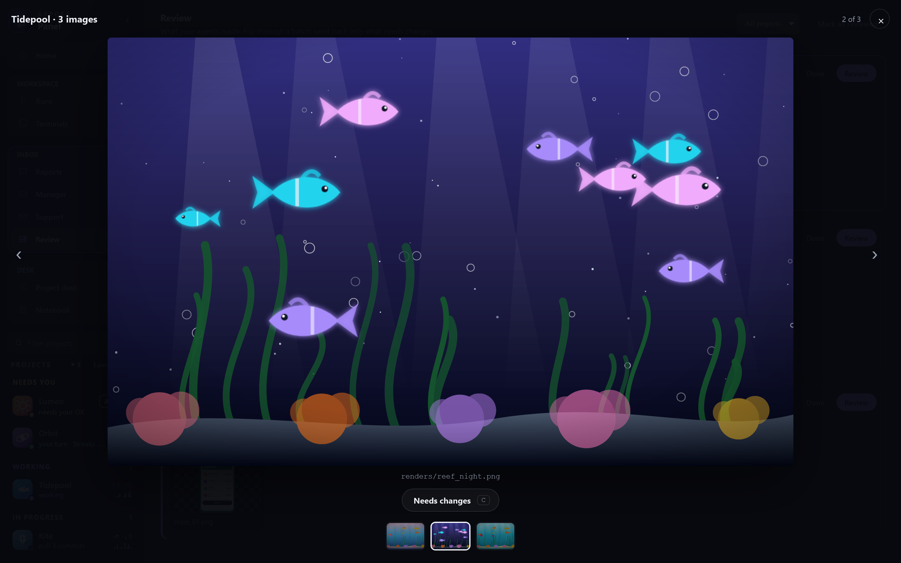
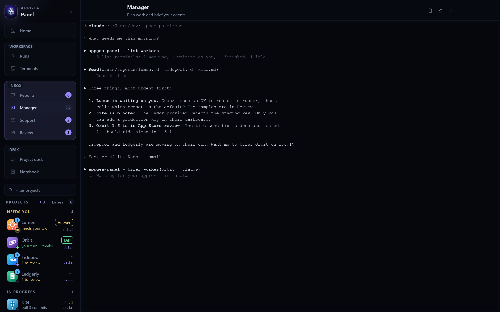

<div align="center">


# Appgea Panel

**Run a dozen coding agents across all your projects, and only look up when one needs you.**


[**Set it up →**](docs/SETUP.md) &nbsp;·&nbsp; [User guide](docs/USER-GUIDE.md) &nbsp;·&nbsp; [Docs](docs/README.md) &nbsp;·&nbsp; [Contributing](CONTRIBUTING.md)

</div>

---

You have more apps than attention. Agents can work on all of them at once, but then you spend
your day tab-hopping between terminals, wondering who's stuck on a permission prompt, who
finished an hour ago, and what each one actually changed.

**Panel is the desk for that job.** Your agents run in real terminals, in their real CLIs. Panel
watches every session, sorts your projects by what they need from you, and turns each finished
turn into a report you can act on in one click.

- 🧭 **Know who needs you.** Projects sort themselves into lanes: *Needs you*, *Working*,
  *Shipping*, *Live*, *Quiet*. A permission prompt can be answered from the sidebar.
- 🖥️ **Every agent on one wall.** Claude, Codex, Grok, opencode, plain shells, across every
  project, live. Switching projects changes what you *see*, never what's *running*.
- 📬 **Reports, not scrollback.** Agents file a headline, an outcome, screenshots and code refs
  when they're done, blocked or need a decision.
- 🎞️ **Review what they made.** Renders, sounds and videos collect in Review. Flag what needs
  changing and your notes go straight into that agent's terminal. The redo sits next to the
  original.
- 🔗 **Agents point, you click.** `panel:review`, `panel:work:lib/auth.dart:88`, `panel:git`,
  `panel:manager` become buttons on a report and ⌘/Ctrl-click links in the terminal.
- ✍️ **An editor that knows an agent is typing.** Gutter marks for what the agent just wrote,
  edit replay, conflict handling when you both touch the same file.
- 🧠 **A Manager above the workers.** One agent that reads every report, plans across projects
  and briefs workers, only after you approve the exact prompt.

## A tour

### The wall: every agent, live

Agents and shells across four projects, plus the Manager. The sidebar already knows Lumen is
waiting on a permission, Orbit finished its turn, and Tidepool left renders to review.


### Review: what your agents made

Renders, screenshots and sounds land in batches. Flip through one, press `C` on what needs
changing, and your notes go straight back into that agent's terminal.





### The Manager: one agent above the workers

It reads every report, tells you what needs you in order, and briefs a worker only after you
approve the exact prompt.



<table>
<tr>
<td width="50%" valign="top">

**Home.** Every project, its branch and changes, and what each agent last reported.


</td>
<td width="50%" valign="top">

**Reports.** Updates from every project in one feed, each with an outcome and one-click
**Review**, **Code** and **Git** buttons.


</td>
</tr>
<tr>
<td width="50%" valign="top">

**Dashboard.** The next move, the files the agent changed for *this* request, and git in one
card.


</td>
<td width="50%" valign="top">

**Work.** A real editor with tabs, breakpoints and go-to-definition. The gutter shows what the
agent just wrote.


</td>
</tr>
<tr>
<td width="50%" valign="top">

**Project.** One project's agent and shells, with every agent CLI one click away.


</td>
<td width="50%" valign="top">

**Tabs layout.** Prefer one terminal at full size? A second tab row, grouped by project. ⌘⇧L
switches.


</td>
</tr>
</table>

<sub>Screenshots use a made-up portfolio. [CONTRIBUTING.md](CONTRIBUTING.md#screenshots) shows how
to regenerate them.</sub>

## Quick start

You need Rust, the Tauri CLI 2, Node 22.12+, Python 3 and at least one agent CLI. The
[setup guide](docs/SETUP.md#1-check-your-tools) lists them with one-line checks.

```sh
git clone https://github.com/Appgea/panel.git panel
cd panel/next

./launcher/build-app.sh /Applications                              # macOS
powershell -ExecutionPolicy Bypass -File launcher\build-app.ps1    # Windows
```

The first build takes 10–20 minutes, later ones a few. Open **Appgea Panel**, click **Add
project**, pick a repo, hit **Start Claude**, and give it a task.

**→ [Full setup guide](docs/SETUP.md)**: first run, agents, keys, updating, troubleshooting.

## Works with the agents you already use

Panel hosts each agent's own CLI from your `PATH`. No wrappers, and your agent logins stay with the agents.

| agent | how well Panel sees it |
|---|---|
| **Claude Code** | full: live status, permission prompts, edit replay, reports, Review |
| **Codex** | reports and panel tools |
| **Grok** | reports through a small script |
| **opencode**, Kimi, GLM, DeepSeek Harness, your shell | a real terminal on the wall |

If Panel's wiring is missing, the agent still launches as its plain CLI.

## Yours, on your machine

- **Local only.** Agents talk to Panel over `127.0.0.1`. Your portfolio lives in `~/.appgeapanel`
  and ships with no one else's content: structure, templates and empty indexes.
- **Shipped code is read-only, your data is writable.** One file decides which is which.
- **No secrets in the bundle.** Credentials stay in the Keychain or a module's private state, and
  the build **refuses to ship** if anything credential-shaped survives.
- **Extensible.** Optional modules (Git manager, RevenueCat, server health, support inbox) add
  tabs and screens. [Write your own](docs/MODULES.md).

## Documentation

| | |
|---|---|
| [Setup guide](docs/SETUP.md) | install, first run, update, troubleshoot |
| [User guide](docs/USER-GUIDE.md) | every screen, key and workflow |
| [Design](next/README.md) · [Work editor](next/WORK.md) | why it is shaped this way |
| [Architecture](docs/ARCHITECTURE.md) · [Backend](docs/BACKEND.md) | crates, event flow, commands |
| [Protocol](docs/PROTOCOL.md) | wire an agent to Panel: routes, hooks, MCP tools, Panel links |
| [Configuration](docs/CONFIGURATION.md) · [Modules](docs/MODULES.md) | config files, the ops tree, extensions |

## Status

**Public alpha.** Core workflows are usable; expect rough edges. Found one?
[Open an issue](https://github.com/Appgea/panel/issues). See
[CONTRIBUTING.md](CONTRIBUTING.md) for dev mode and the checks to run before a PR.

## License

MIT. See [LICENSE](LICENSE).
