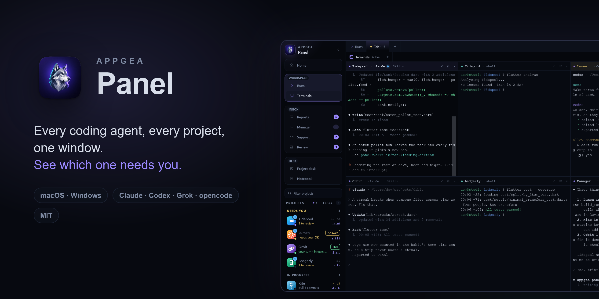
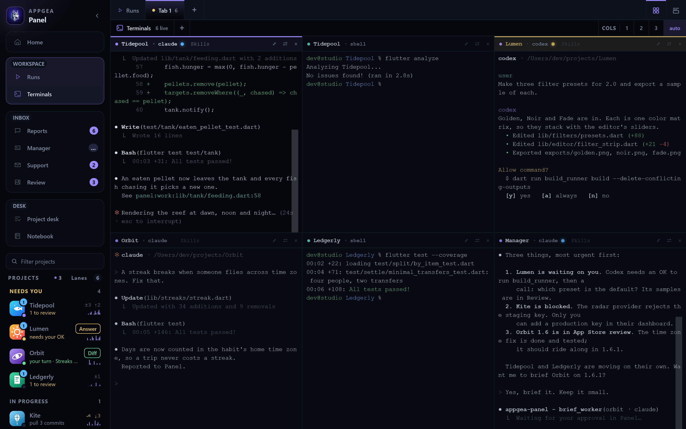
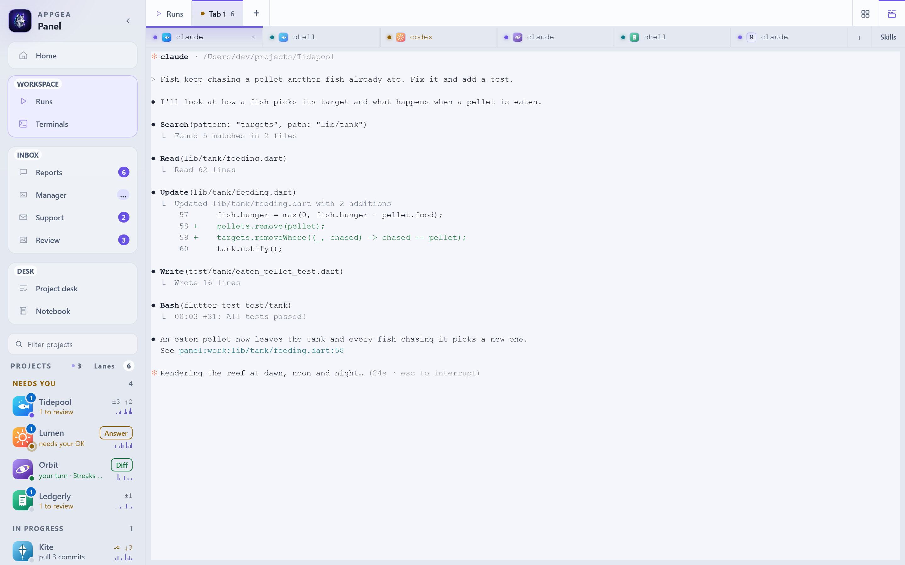
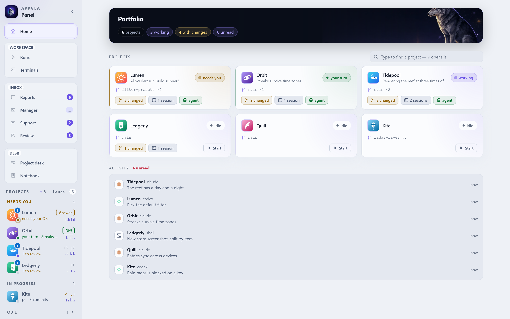
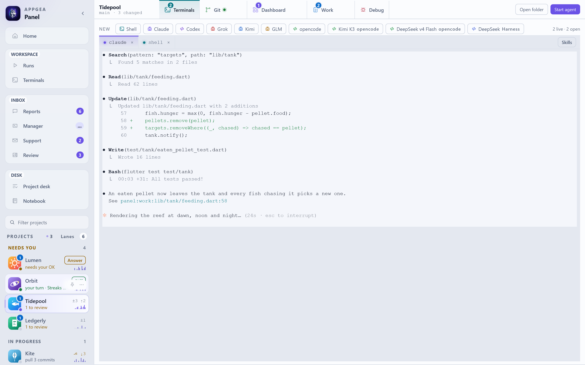
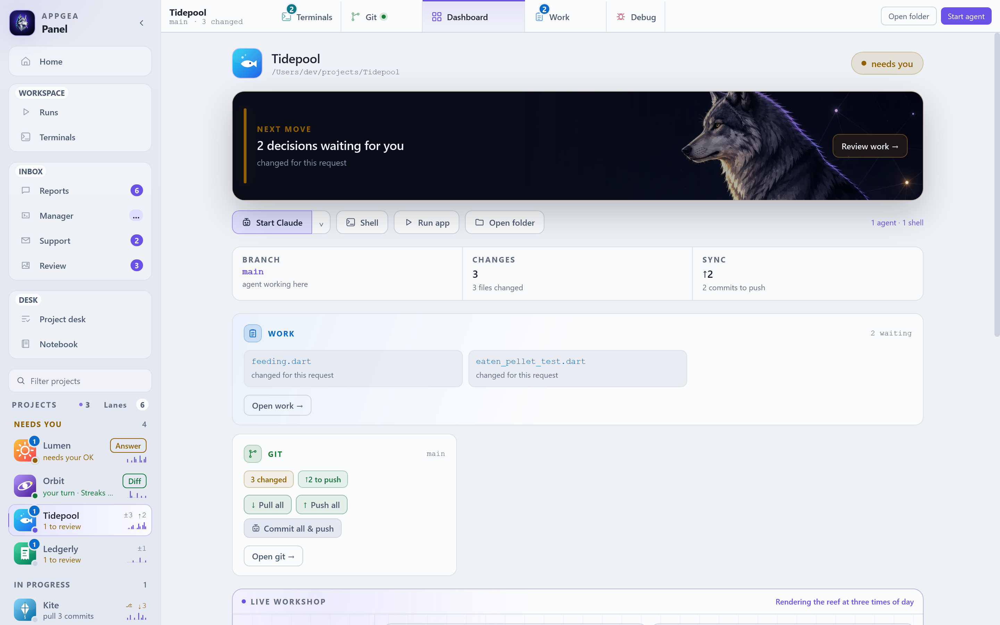
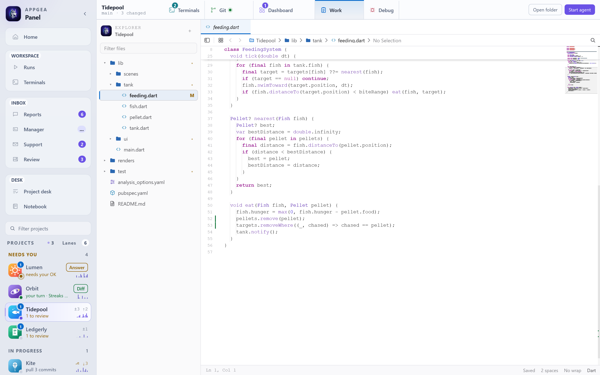
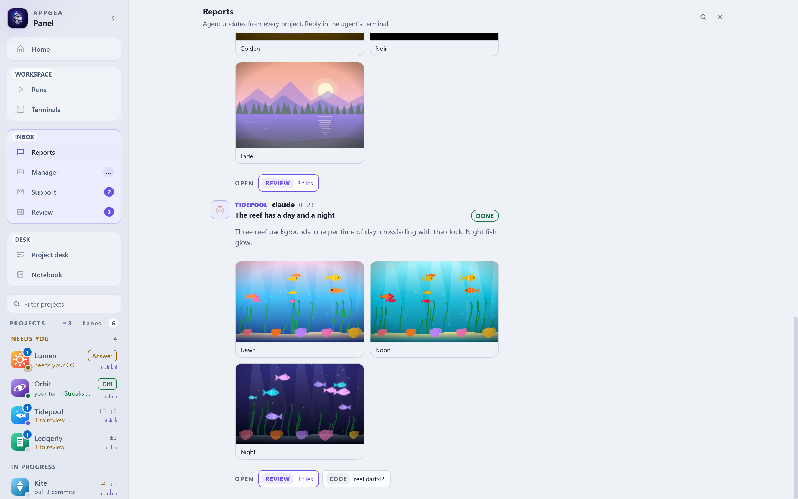

# Appgea Panel



**macOS public alpha.** Core workflows are usable. Expect rough edges and report bugs.

An admin panel for a portfolio of apps, with an editor that knows an agent is typing in your
file.

Panel runs coding agents in real terminals across several projects at once, watches what they do,
and tells you which one needs you. Each project owns an agent, a working set of files, a dashboard
and a feed. Selecting a project changes what you SEE. It never tears down what is RUNNING.

The Work tab has tabs, a status bar, breakpoints, go-to-definition and a real editor. It is not a
general-purpose editor for everyone. It is the editor for a human sharing a repository with an
agent. See [`next/WORK.md`](next/WORK.md).

[`next/README.md`](next/README.md) is the design document: what the zones are, how routing works,
how to add a visual. This file is how to get it running.

Full documentation is in [`docs/`](docs/README.md): a [user guide](docs/USER-GUIDE.md),
[architecture](docs/ARCHITECTURE.md), [backend reference](docs/BACKEND.md),
[protocol reference](docs/PROTOCOL.md), [configuration](docs/CONFIGURATION.md) and
[extensions](docs/MODULES.md).

- [Screenshots](#screenshots)
- [Requirements](#requirements)
- [Install](#install)
- [First run](#first-run)
- [Terminals](#terminals)
- [Agents](#agents)
- [Update and uninstall](#update-and-uninstall)
- [Troubleshooting](#troubleshooting)
- [How it is organized](#how-it-is-organized)

## Screenshots

The screenshots use a made-up portfolio. [CONTRIBUTING.md](CONTRIBUTING.md#screenshots) shows how
to regenerate them.

**Terminals.** Every agent and shell across your projects, live, on one wall. The sidebar sorts
projects into lanes by what they need from you.



**Terminal tabs.** The other layout: a row of terminal tabs under the top tabs, one terminal at
full size.



**Home.** Every project, its branch and changes, and what each agent last reported.



**Project.** One project's agent and shells, live, with every agent CLI one click away.



**Dashboard.** The next move, the files the agent changed for this request, and git in one card.



**Work.** The editor. Change marks in the gutter show what the agent just wrote.



**Reports.** Agent updates from every project in one feed, with an outcome on each.



## Requirements

macOS first, Windows too (see [Windows](#windows)). There is no Linux path today. Keep about 3 GB
free for the Rust build.

| you need | why | install | check |
|---|---|---|---|
| Xcode command line tools | linking the macOS bundle, `git` | `xcode-select --install` | `xcode-select -p` |
| Rust (stable) | the app is Tauri v2 | [rustup.rs](https://rustup.rs) | `cargo --version` |
| Tauri CLI 2 | builds the bundle | `cargo install tauri-cli --version "^2" --locked` | `cargo tauri --version` |
| Node 22.12+ or 20.19+ | the frontend is Vite + TypeScript | [nodejs.org](https://nodejs.org) or `brew install node` | `node --version` |
| Python 3.9+ | the session hook, the panel MCP, the module hosts | ships with the command line tools | `python3 --version` |
| an agent CLI | Panel hosts `claude` by default | `npm install -g @anthropic-ai/claude-code` | `claude --version` |

Run each check in a new Terminal window. Panel reads `PATH` from your interactive login shell, so
a tool that works there works in Panel.

## Install

1. Clone the repository.

   ```sh
   git clone https://github.com/Appgea/panel.git panel
   cd panel/next
   ```

2. Build and install the app.

   ```sh
   ./launcher/build-app.sh /Applications
   ```

   Omit the path to install onto the Desktop. The app is named **Appgea Panel**.

   The first build compiles the whole Rust dependency tree and takes **10–20 minutes**. Later
   builds take a few minutes. Frontend dependencies install themselves on the first run.

3. Open **Appgea Panel** from Applications.

The build signs the app with your Apple Development certificate when you have one, and ad-hoc
otherwise. It is not notarized. An app you built yourself normally opens without a warning. If
macOS blocks it, use **System Settings → Privacy & Security → Open Anyway**. See
[Apple's instructions](https://support.apple.com/102445).

To build without installing over your daily copy, pass an empty folder:
`./launcher/build-app.sh /tmp/panel-check`.

### Windows

You need Git for Windows (Panel runs project scripts through its Git Bash), Rust with the MSVC
build tools, `cargo install tauri-cli --version "^2" --locked`, Node, Python 3 (as `python`) and
an agent CLI. From PowerShell in `panel\next`:

```powershell
powershell -ExecutionPolicy Bypass -File launcher\build-app.ps1
```

It puts **Appgea Panel.exe** and a **Rebuild Appgea Panel** shortcut on the Desktop (`-Dest
<folder>` picks another place). The exe reads `host\` from the checkout, so keep the checkout where
it is. `launcher/build-windows.sh` builds a self-contained NSIS installer instead. Shortcuts use Ctrl
where macOS uses ⌘. Ctrl+C copies when the terminal has a selection and interrupts otherwise, and
F11 is full screen. A Bridge-era `~\.appgeabridge` is reused through a junction.

## First run

1. Click **Add project** in the sidebar and pick a repository folder.
2. The project opens on its **Dashboard**. Click **Start Claude**, or pick another agent from the
   arrow next to it.
3. Give the agent a task in its terminal. Panel watches the session from there.

The sidebar sorts projects into lanes: **Needs you** (an agent waits on a question or a
permission, finished its turn, or left work to review), **Working**, **Shipping**, **In
progress**, **Live** and **Quiet**. Shipping and Live come from `ops/portfolio.yaml`. Quiet folds
away. Each row says what is waiting, its git state and two weeks of commits. Hover a row for the
next move, the last report and quick actions. You can answer a Claude permission prompt from
there. ⌃1…⌃9 open projects, and typing `tavla release` in the filter runs that action on that
project. Agents post updates to **Reports**. Changed files appear on the Dashboard and in
**Work**.

Panel creates its home on first launch:

```
~/.appgeapanel/
  config.json      your portfolio: projects, groups, agent choice, devRunner
  ops/             seeded from the shipped template, yours to edit
  brain/           the append-only note log
  modules/         modules you install yourself
  state/<module>/  each module's private writable dir
```

Nothing here comes from anyone else's machine. The ops tree ships as **structure with no
content**: schema comments, `_template.md` files, empty indexes. Rewrite
`~/.appgeapanel/ops/AGENTS.md` in your own words. It is the personality of the thing.

The editor and project tools can change your project files. Shared workflows create links in
agent skill folders such as `~/.claude/skills`. The personal notebook lives at
`~/.appgea/notes.md`.

## Terminals

The Terminals screen has two layouts. Pick one in **Settings → General → Terminals**,
with the switch at the right end of the top row, or with ⌘⇧L.

- **Grid** shows every terminal of a tab at once.
- **Tabs** adds a second row with one tab per terminal, grouped by project. One terminal shows at
  full size.

| keys | does |
|---|---|
| ⌘1…⌘9 | open a top tab |
| ⌘⌥↑ / ⌘⌥↓ | previous / next top tab (tabs layout) |
| ⌘⌥← / ⌘⌥→ | previous / next terminal (tabs layout), or the tile beside it (grid) |
| ⌥1…⌥9 | open a terminal of this tab |
| ⌃Tab / ⌃⇧Tab | next / previous terminal |
| ⌘N, ⌘T, ⌘W | new terminal, new shell here, close |
| ⌘⌥1…⌘⌥9 | move the terminal to that tab |

Every chord can be changed in **Settings → Shortcuts**. Drag a terminal tab to reorder it, or
onto a top tab to move it there.

## Agents

Each terminal button runs the CLI of the same name from your `PATH`. Install the ones you use.

| button | runs | Panel wiring |
|---|---|---|
| Claude | `claude` | session hook and panel tools, so status and reports are exact |
| Codex | `codex` | panel tools, so reports reach Panel |
| Grok | `grok` | a small report script through its rules flag |
| Kimi, GLM | `kimi`, `glm` | a plain terminal |
| opencode | `opencode`, with a `--model` for the Kimi K3 and DeepSeek v4 Flash buttons | a plain terminal |
| DeepSeek Harness | `dshline` | a plain terminal |
| Shell | your login shell | a plain terminal |

A missing panel never breaks an agent. Panel then launches the plain CLI.

**DeepSeek Harness.** Install [DeepSeek Harness](https://www.deepseek.com/en/harness/) and its
community [dshline terminal interface](https://github.com/riesbri/dshline). Confirm
`dshline --version` works in your shell. Configure your DeepSeek key in Harness. Panel uses that
existing setup. Restoring a DeepSeek terminal opens dshline's saved-session picker.

## Update and uninstall

Update:

```sh
cd panel
git pull
./next/launcher/build-app.sh /Applications
```

Your portfolio in `~/.appgeapanel` is untouched by a rebuild.

Panel used to be called Bridge. If `~/.appgeabridge` exists and `~/.appgeapanel` does not, the
first launch links the new name to the old folder. Nothing moves, and your projects stay.
The RevenueCat module stores its key under a new Keychain name, so enter that key once more.

Uninstall: quit Panel and delete **Appgea Panel.app**. Your portfolio, ops tree and module state
stay in `~/.appgeapanel`. Delete that folder too only if you want them gone.

## Troubleshooting

**`error: no such command: tauri`.** Install the Tauri CLI:
`cargo install tauri-cli --version "^2" --locked`.

**`could not execute process /opt/homebrew/bin/sccache`.** An older checkout pinned the `sccache`
compiler cache. Run `git pull`, or delete `next/.cargo/config.toml`. To keep the cache on purpose,
see [CONTRIBUTING.md](CONTRIBUTING.md#faster-rust-builds).

**`npm error code EBADENGINE`.** Your Node is too old. Install Node 22.12 or newer.

**An agent button opens a terminal that says `command not found`.** Panel cannot see that CLI.
Check it with `zsh -ilc 'command -v claude'`. Fix your `~/.zshrc` until that prints a path, then
restart Panel.

**macOS asks again for Desktop or Documents access after every rebuild.** An ad-hoc signature
changes with each build, so macOS forgets the grant. Install an Apple Development certificate in
Xcode, or set `PANEL_SIGN_IDENTITY` to a signing identity before you build.

**Start fresh.** Quit Panel and rename `~/.appgeapanel`. If you came from Bridge, rename
`~/.appgeabridge` too, or the next launch links it again. The next launch seeds a new home.

## How it is organized

### Two roots

Everything Panel ships is read-only. Everything you own is writable. `paths.rs` is the one place
that decides which is which.

| root | is | holds |
|---|---|---|
| resources | `host/` in a checkout, `Contents/Resources/host` installed | session hook, panel MCP, module hosts, schemas, `ops-template/` |
| user | `~/.appgeapanel` | `config.json`, `ops/`, `brain/`, `modules/`, `state/` |

A module never writes next to its own code. Installed, a module's folder is inside a signed
bundle, so a cache write there works on the machine that built it and fails on every other one.

### Environment overrides

Every one of these has a working default. Set them only if your layout differs.

| var | changes |
|---|---|
| `PANEL_USER_HOME` | where your portfolio and ops tree live |
| `PANEL_PRIVATE=1` | build the unshipped modules too |
| `PANEL_SIGN_IDENTITY` | the code signing identity `build-app.sh` uses |
| `PANEL_STATE_DIR` | a module's writable dir, set by Panel when it launches one |

### Modules

Modules are optional companions. Panel launches, hosts agents and serves its dashboard with
every one of them absent. A module declares itself in `module.json`, and `stage-resources.sh`
ships only the ones marked `"visibility": "public"`. A module that forgets the field stays home.

Shipped: `git-manager`, `revenuecat`, `server-health`, `support`. See
[`host/modules/README.md`](host/modules/README.md) for the manifest format.

A module can also live in its own repo. Link its folder into `~/.appgeapanel/modules/<name>` and
Panel loads it like a shipped one. The Release tab appears only when a `release-manager` module
is installed that way.

### Secrets

Credentials live in the macOS Keychain or under `~/.appgeapanel/state/<module>/secrets/`, both
outside every git tree. `stage-resources.sh` sweeps state, caches and `.git` out of the bundle,
then **refuses to build** if anything credential-shaped survived.

## Contributing

See [CONTRIBUTING.md](CONTRIBUTING.md) for dev mode, the checks to run before a push, and how to report a bug.

## License

MIT. See [LICENSE](LICENSE).
