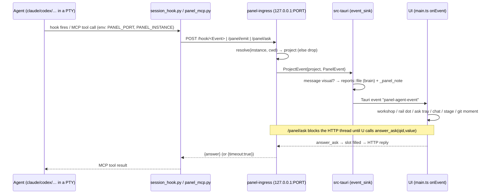

# Architecture

How Appgea Panel is built and how an agent's activity reaches your screen. For the product
philosophy ("agents are hosted, not driven"; "the project is the unit") read
[`next/README.md`](../next/README.md) first — this file doesn't repeat it. Command-level detail is in
[BACKEND.md](BACKEND.md); wire formats are in [PROTOCOL.md](PROTOCOL.md).

## 1. Workspace layout

```
panel/
├─ host/                       READ-ONLY resources shipped inside the app (Resources/host)
│  ├─ session_hook.py          Claude hook forwarder (stdin JSON → POST /hook/<event>)
│  ├─ panel_send.py            universal "send a report" CLI for any engine
│  ├─ mcp/panel_mcp.py         stdio MCP server: panel_emit, send_to_user, ask_user
│  ├─ cpo-response.schema.json legacy Manager response schema (see §8)
│  ├─ modules/<name>/          one-shot Python module hosts (+ module.json)
│  └─ ops-template/            empty shape of an ops tree, copied to ~/.appgeapanel/ops on first run
├─ protocol.json               core visual/ask vocabulary (agent-facing doc source)
├─ motion.json                 animation id ledger (namespaced <module>:<name>)
├─ docs/                       this documentation
└─ next/                       the Rust + web app
   ├─ crates/
   │  ├─ panel-core/           event vocabulary (PanelEvent, ActivityState, SessionConfig)
   │  ├─ panel-ingress/        loopback HTTP listener, router, blocking asks, edit-replay log
   │  ├─ panel-terminal/       PTY ownership (portable-pty), screen tail, process-tree kill
   │  └─ panel-store/          tiny atomic JSON store (see note)
   ├─ apps/desktop/
   │  ├─ src-tauri/            composition: commands, agent launch wiring, URI schemes (BACKEND.md)
   │  └─ ui/                   Vite + TypeScript web UI (xterm.js, CodeMirror 6)
   ├─ protocol/                JSON Schemas (panel-events, panel-ui)
   ├─ launcher/                build / install scripts
   └─ scripts/                 screenshots, skill consolidation
```

Dependency rule from `next/README.md`, kept deliberately: **panel-core** knows only events;
**panel-ingress** doesn't know Tauri; **panel-terminal** doesn't know what an agent is; **the UI
doesn't know what a hook is**. `src-tauri` is the only place they meet.

> `panel-store` is a workspace member and a declared dependency of `src-tauri`, but no code in
> `src-tauri` references `JsonStore` — persistence today is hand-written JSON (`config.json`, `wall.json`,
> `modules.json`, leases…). Treat the crate as scaffolding. (Checked by grep; unverified at runtime.)

## 2. The crates

### panel-core
`PanelEvent` — serde-tagged by `kind` (snake_case). Variants: `SessionStarted`, `AgentText`,
`AgentStatus{status,detail}`, `Activity{activity_id,state:started|finished,label,detail,success}`,
`FileChanged{path,summary}`, `AskRequested{qid,spec}`, `AskResolved{qid,answered}`,
`VisualRequested{view,title,payload}`, `TurnFinished{success,summary}`, `Error{session_id?,message}`.
`session_id()` returns the owning session. `spec` and `payload` are opaque `Value`s on purpose:
Rust never inspects them, so adding a visual or ask kind needs no Rust change.

### panel-ingress
- `Ingress::serve(sink)` binds `127.0.0.1:0` (ephemeral — deliberately not the legacy fixed 7391, so it
  coexists with the old Python Panel). One thread accepts; **one thread per request**, because
  `/panel/ask` parks for minutes and must not stall hook traffic.
- **Router**: `routes: instance → {project, cwd}` (agents), `projects: id → root` (all registered
  projects). `resolve(instance, cwd)`: exact instance first; else deepest registered root containing
  `cwd` (deepest-wins, so a nested project isn't stolen by its parent). Unknown → event **dropped**
  (Panel shows the agents it launched, not every `claude` on the machine).
- **Ask slots**: `qid → {answer, condvar}`. `answer(qid, value)` fills the slot and wakes the parked thread.
- **Edit replay log** (`ChangeLog`): memory-only. Per `(project, file)` up to 24 steps; global caps
  512 steps / 32 MiB; files over 1 MB aren't tracked; ≤16 pending before-images. Cleared per project on
  every `UserPromptSubmit`.
- **Skill uses**: per-instance list (≤1000, names ≤256 chars) from `PostToolUse` `Skill`.
- `EventSink` = `Arc<dyn Fn(ProjectEvent)>`; desktop's sink emits Tauri `panel-agent-event` (after
  filing `message` reports).

### panel-terminal
- `SpawnSpec::shell(cwd, cols, rows)` → `.run(program,args)` → `.with_env(k,v)`; `None` program = login shell.
  `.answering_cursor_query()` replies to `ESC[6n` (Windows ConPTY blocks output until someone does; a run PTY has no xterm to reply).
- `TerminalManager`: `spawn`, `write`, `resize`, `close`, `take` (detach so a slow kill happens *outside* the manager lock), `pid`, `foreground_pid`, `is_running`, `screen`.
- **Screen tail**: last 192 KB of raw PTY output (escape sequences kept), cut at a line boundary so a colour escape is never sliced. Replayed into a fresh xterm on restore.
- **UTF-8 safe reads**: an unfinished multi-byte tail is carried into the next read.
- **Process-tree kill**: Unix — SIGTERM to every descendant (agents run commands in their own groups, so SIGHUP from PTY close doesn't reach them), 1 s grace, then SIGKILL. Windows — a **job object** with kill-on-close (`taskkill /T` also used); `.cmd` shims (npm-installed `codex`, `opencode`) are resolved to the real exe or `node script`, bypassing `cmd.exe` quoting.
- **Busy detection**: `foreground_pid != pid` ⇒ something is running. Background helpers don't count.

### panel-store
`JsonStore::{load,save}`: file name sanitized to `[A-Za-z0-9_-]`, write to `*.json.tmp` then rename (atomic).

## 3. End-to-end event flow



Two deliberately unequal channels:

| channel | origin | guarantee |
|---|---|---|
| **hooks** `POST /hook/<event>` | Claude Code lifecycle hooks via `session_hook.py` | fires because the tool *ran* (file edits, git moments, turn start/stop, permission waits, Skill use) |
| **panel** `POST /panel/emit`, `/panel/ask` | the model calling MCP tools / `panel_send.py` | fires because the model *chose* to |

Panel injects **nothing** back into the model's context (hooks reply `{}`); it watches, it doesn't steer.
The forwarder is **fail-open**: any error ⇒ exit 0, no output.

How the UI reacts to each event kind (`ui/src/main.ts` → `onEvent`):

| event | UI effect |
|---|---|
| `session_started` | project marked running; workshop gets the agent |
| `agent_status` | `thinking` begins a turn (clears the unseen-done flag); `waiting`/`asking` → "needs you" + OS attention; `idle/done/complete/error/failed` end the phase |
| `activity` | label matching `test|check` / `build|compile` → workshop checkpoint |
| `file_changed` | workshop station for the file; Work badge; refresh git; mark editor buffer dirty-from-agent (conflict flow) |
| `visual_requested` | by `view`: `message` → Reports feed + stage; `showcase` → Reports + stage; `worklist` → Work list; `git-*` → workshop checkpoint + Git tab animation if visible; `sim` → Run screen; anything else → `renderView` onto the Dashboard stage |
| `ask_requested` | ask tray opens; status `asking`; OS notification (urgent) |
| `ask_resolved` | tray card closes; status back to working if no other ask |
| `turn_finished` | idle; if you're not looking at that project → "finished" attention + green dot until opened |
| `error` | workshop error phase |

## 4. Launching an agent (`start_session` + `launch.rs`)

1. Resolve the project (or the Manager pseudo-project from the ops tree). Refuse collections and missing folders.
2. Create a `SpawnSpec::shell(cwd)`. For non-shell kinds: mint `instance` (= session id for fresh sessions; reopen keeps the old id).
3. Build wiring by kind:

| kind | wiring |
|---|---|
| `claude` | `--append-system-prompt <rule>` `--settings <tmp>/appgea-panel-settings-<instance>.json` `--mcp-config <tmp>/appgea-panel-mcp-<instance>.json` |
| `codex` | `-c mcp_servers.appgea-panel.{default_tools_approval_mode="approve",command,args,env.PATH,env.HOME,env.PANEL_PORT,env.PANEL_INSTANCE}` `-c developer_instructions=<rule>` (Codex passes the MCP only the env it's given, hence PATH/HOME) |
| `grok` | `--rules <rule>` (no session-scoped MCP flag) |
| `kimi`, `glm`, `opencode*`, `dshline`, anything new | env only |
| `shell` | nothing; no ingress registration |

4. Settings JSON registers `session_hook.py` on `PreToolUse` (matcher `Edit|Write|MultiEdit|NotebookEdit`), `PostToolUse` (those + `Bash` + `Skill`), `UserPromptSubmit`, `Stop`, `Notification`, and pre-allows `mcp__appgea-panel__{panel_emit,send_to_user,ask_user}`. `Stop` only (not `SubagentStop`) so a subagent finishing isn't reported as your turn. Hook command is `<python> '<session_hook.py>'` (`python3` on Unix, `python` on Windows) with the path single-quoted for the shell, because the macOS install path contains a space.
5. The injected **rule** (worker): talk to the human in the terminal; `send_to_user` only at real checkpoints (done / blocked / needs decision / made something), with title, one-sentence text, `outcome`, `flow` code refs, captioned `images`; fall back to `python3 panel_send.py …` if the MCP is unavailable. The **Manager** rule differs: it's the Manager inside Panel, never edits app code, never files reports, reads per-project report logs from `<user>/brain/reports/`.
6. Skill overlay: Claude gets `skillOverrides` merged into the settings file; Codex gets merged `skills.config` `-c` args.
7. `ingress.register_agent(instance, project, root)` **before** the PTY spawns (a hook can fire within milliseconds).
8. Env: `PANEL_PORT`, `PANEL_INSTANCE`, `PANEL_SEND`. argv order: resume flags → model args → wiring → skill args (resume goes first because CLIs read it as a mode).

Everything degrades: a missing shim omits its flag and the agent launches plain.

## 5. Persistence

| what | where | format / notes |
|---|---|---|
| Portfolio, groups, `devRunner`, `plainView`, `opsRoot` | `~/.appgeapanel/config.json` | read-modify-write of the whole document so foreign keys survive; watched for external edits |
| Ops tree (the "brain") | `~/.appgeapanel/ops/` (seeded from `ops-template`, never overwritten) | Markdown/YAML; the Manager reads/writes it |
| Agent report logs | `~/.appgeapanel/brain/reports/<project>.md` | append-only |
| Shared workflows | `~/.appgeapanel/skills/` | `SKILL.md`; linked into Claude/Codex/`~/.agents/skills` |
| Module state | `~/.appgeapanel/state/<module>/` | `PANEL_STATE_DIR` |
| User modules / installed set | `~/.appgeapanel/modules/`, `modules.json` | |
| Terminal wall | OS app-local-data `wall.json` | written by `shutdown_panel`; consumed once on restore; sim runs and tasks excluded |
| Breakpoints | Panel user state (not the repo) | |
| Device leases | `~/.panel/leases.json` (+ `.lock`) | shared with `common/lease.py` |
| Notebook | `~/.appgea/notes.md` | outside the user root on purpose |
| Review queue | webview `localStorage` | this window's to-do list |
| Keymap, preferences | webview `localStorage` (`panel-keymap`, `panel-prefs`) | only overrides stored |
| Edit replay | memory only | bounded (see ingress) |
| Ingress port | `~/.appgeapanel/ingress-port` | removed on clean exit |

**Wall restore:** per terminal three things are saved — what it was (project/kind/cwd), its title, and its screen tail. On launch each is re-forked in the same folder with the screen replayed under a dated banner; agents that can resume get resume args: `claude --continue`, `codex resume --last`, `dshline --resume`; any other engine opens fresh (opt-in list: a wrong guessed flag would fail the whole terminal). Processes do **not** survive the app — a running build or in-flight turn is gone.

## 6. Build and packaging

| script | does |
|---|---|
| `launcher/stage-resources.sh` | Builds `next/target/package/host`: copies the shims/schemas/mcp/ops-template, then each module whose `module.json` says `"visibility":"public"` (**fail-closed**: missing field ⇒ stays home). `PANEL_PRIVATE=1` ships the rest. `config.json` is deliberately never bundled. |
| `launcher/prepare-ui.sh` | `npm ci --engine-strict` on first run (Node ^20.19 or ≥22.12). |
| `launcher/build-app.sh [dest]` | macOS: stage → prepare → `cargo tauri build --bundles app` → installs `Appgea Panel.app` (default Desktop). |
| `launcher/build-app.ps1 [-Dest]` | Windows: uses Git-for-Windows bash for the staging scripts; `cargo tauri build --no-bundle` → installs the **bare exe** + a "Rebuild" shortcut. With no `host\` beside the exe, Panel reads `host\` from the checkout — keep the checkout where it is. |
| `launcher/build-windows.sh` | Windows NSIS installer; `host\` shipped inside. Needs Rust + MSVC build tools + Node + Python + `cargo install tauri-cli`. |
| `launcher/make-launcher.sh` | macOS: a tiny `.app` that launches dev mode (logs `~/Library/Logs/appgea-panel.log`). |
| `dev.command [--no-watch]` | `cargo tauri dev`; Vite HMR on `127.0.0.1:1420`; `PANEL_FROZEN=1` = `--no-watch`. Frontend edits never drop sessions; Rust edits restart the app. |

Resources root resolution: bundled `Resources/host` if present; else the checkout (`PANEL_HOME` → `next/`, `host/` beside it).
`.cargo/config.toml` names a Homebrew `sccache` wrapper that doesn't exist on Windows; the Windows scripts blank it (`RUSTC_WRAPPER=` / `--config build.rustc-wrapper=''`).

## 7. Tests

| command | covers |
|---|---|
| `cargo test --workspace` (in `next/`) | core wire format; ingress (routing, deepest-wins, hook→event mapping, git/work-checkpoint classification, replay capture, blocking-ask round trip, ask **timeout**); terminal (real PTY round trip, env injection, tree kill incl. SIGHUP-ignoring servers); store; launch args; paths/migration; modules; android/sim parsing; origin guard |
| `cd next/apps/desktop/ui && npm run check` | `tsc --noEmit` |
| `npm test` (same dir) | `tests/keymap.test.mjs`, `tests/project-icons.test.mjs` |
| `python3 next/launcher/test_startup.py` | fresh checkout in a path with spaces installs deps once, keeps no watcher |
| `host/modules/*/test_*.py` | module hosts (`git-manager`, `revenuecat`, `support`) |
| `PANEL_SELFTEST=1 appgea-panel-desktop` | headless: each agent kind actually spawns |

## 8. Differences from the old Python Panel

`PANEL.md` used to describe a Python server (`panellib/panel.py`, `web/dash/*.js`, `ttyd`, tmux, a
right-hand companion panel, `GET /panel`, `/terminal/attach`). That stack is not in this tree. Today:

| old | now |
|---|---|
| tmux session in the browser via `ttyd` iframe | a real PTY per session (xterm.js), no tmux/ttyd/iframe |
| companion panel + ambient feed + show queue | removed; visuals land on Dashboard stage / Reports / terminal wall; questions in the **ask tray** |
| Python HTTP server on fixed port 7391 | Rust ingress on an ephemeral port; Python shims unchanged |
| `GET /panel`, `/panel/emit|ask|answer`, `/terminal/attach` | only `/hook/<event>`, `/panel/emit`, `/panel/ask`, `/panel/answer` remain |
| animations `note`, `milestone`, `status`, `tool`, `progress`, `git-*` | renderer registry now: `trace card structure showcase educate message sim` + `worklist`/`git-*`/`sim` handled in `main.ts`; unknown → `card` |
| Manager = sandboxed Codex subprocess with JSON action schema | an ordinary agent in a PTY rooted at the ops tree, shaped by `ops/AGENTS.md` (`cpo-response.schema.json` is legacy; no code in `src-tauri` reads it — checked by grep) |
| `plainView` (separate rewrite pass of each reply) | key still present in the default `config.json`; no reader found in the Rust or UI source (unverified) |
| `config.json` in the tree | `~/.appgeapanel/config.json` (copied from the old in-tree one on first run) |

